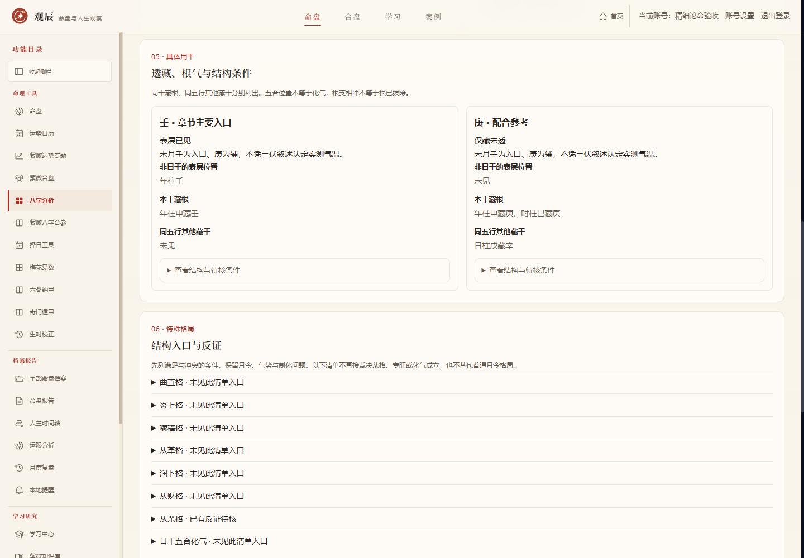
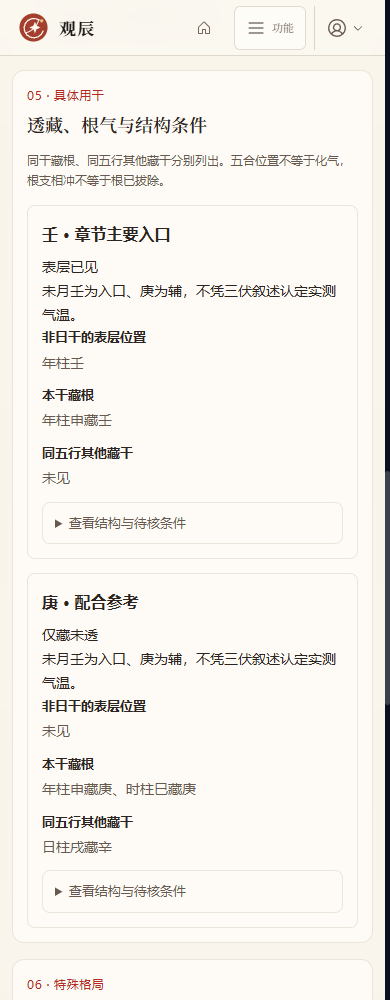
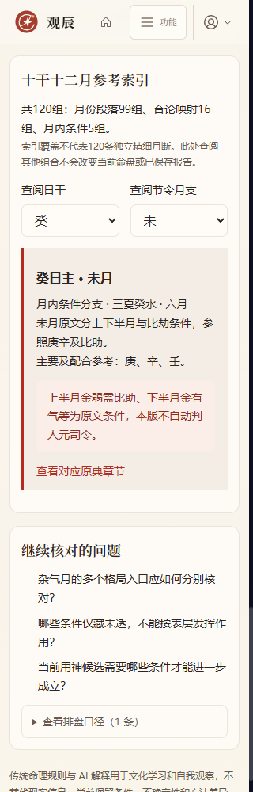

# 八字精细论命深化：月令与条件复核

日期：2026-10-15（UTC+08:00）。这是用户确认的后续深化清单第一项，属于 `1.1.0-dev`，在现有八字论命总览内继续实施。

## 本轮范围

以《穷通宝鉴》当前核对版本补齐十干十二月参考索引，并增加具体用干的透藏、同干根、同五行其他藏干、天干五合及根支相冲复核；将普通格局的既有支持／风险／救应条件与八类特殊格局结构清单并列展示。论命报告与八字连续问答消费同一版本依据，旧报告保持生成时的快照。

入口仍为保存八字后的“八字论命总览”，路径 `/bazi/reading/[id]`。新增“具体用干复核”“特殊格局复核”“月令参考索引”，查阅索引不会修改当前命盘或报告。

## 参考来源与覆盖粒度

来源为 [《穷通宝鉴》十干分论](https://zh.wikisource.org/zh-hans/穷通宝鉴)，按各干三春、三夏、三秋、三冬章节定位。核对日期2026-10-15。只把原典取用讨论改写为条件参考，不保留原文中的贫富、婚姻、健康、寿夭或命运断语。本次未把参考表当成原文完整校勘本，不声称涵盖全部流派。

120组均有明确入口及章节链接，其中：

- 99组对应月份段落，包含章节明列的配合与替代支线。
- 16组来自同干合论或相邻月份合论，页面明确标为“同干合论参考”。例如三夏己土、三冬丁火等，不把合论映射包装成多条独立精细月断。
- 5组带月内条件：乙午、乙酉、壬丑、癸辰、癸未。保留上下半月、秋分、谷雨等原文条件，本轮未实现自动人元司令或自动分支取用，涉及元素标记为“月内条件待核”。不把上下半月直接等同公历15日。

参考月份继续映射保存命盘的节令月支，遵循原有精确交节、时区、真太阳时与晚子时口径；不以公历或农历月份重新计算。原典版本存在差异，如本次核对文本丙亥月列甲戊庚，与其他通行简表可能不同，程序保留来源版本，不静默混入其他表格。

主要参考与条件支线分开。辛酉的甲疏土等条目只有在相关五行位置出现时打开复核入口，仍不证明土厚、湿木、水泛或制化已经成立，不能自动并入固定喜用。原文指定壬与癸等具体干时，逐干记录，不用同五行直接替代。

## 根气与结构

- 日干只作日主参照，不重复当作候选用干的其他表层位置。壬日主本身不能满足壬比助已见条件。
- 完全相同的藏干列作“本干藏根”；同五行不同干另列。例如壬透而子藏癸，不能称作已找到壬的同干根。
- 透出、仅藏、未见、缺时柱分别展示。时柱未知时，未见不能扩大为完整原局缺失。
- 五合只记录天干位置，不断合绊或化气。根支被冲时同时保留根和相冲条件，不宣告拔根、冲开或作用消失。
- 这些证据说明位置和待核条件，不提供旺衰权重、分数或最终效力判定。

## 特殊格局清单

新增曲直、炎上、稼穑、从革、润下、从财、从杀及日干五合化气八类复核入口。清单是本项目的结构预筛，不是原典成立条件的完整等价表达：

- 专旺类分别检查日主元素与三会／三合位置，稼穑以多种库土支作为进一步复核入口，明确未判土势专旺；克日主元素的透干与藏干作为待核反证。
- 从财／从杀分别记录目标五行的其他表层位置、日主根气和印比反证；从杀预筛仅为官杀五行入口，不能把正官自动叫作七杀，不能依数量多或缺项直接判从格。
- 化气只将月干或时干与日干的近邻五合列作入口，年干远合单列；仍需月令、化神根气、争合、妒合与逆势结构复核。
- 状态为结构入口已见、已有反证待核、未见此清单入口、缺时柱暂不裁定。没有反证不等于成立，未通过本清单也不否定其他流派。

普通月令格局继续复用原有完整候选及支持／风险／救应审计，不另立一个互相覆盖的格局结论。最终身强身弱、最终成格破格、特殊格局成立及唯一喜忌的完整裁决树尚未完成，本轮不把它们交给AI补算。

## 版本与历史

- 规则版本 `bazi-reading-v2-monthly-conditional-review`。
- 报告提示版本 `bazi-reading-report-v2-monthly-conditions`。
- 连续问答提示版本 `bazi-chat-monthly-climate-conditions-v19`，按既有机制更新会话依据。
- 规则、来源粒度与复核清单参与报告指纹，新结果不复用旧规则缓存；旧报告仍可读取，界面提示规则不同，可重新生成并保留旧版。
- 沿用现有事实快照与报告版本表，本轮无需数据库迁移，结构仍为v56。账号隔离、备份及删除级联延续原机制。

## 验收

新增精细规则专项640项通过，既有论命专项扩展至300项通过；覆盖120组索引、独立原典月例、来源粒度、同干根区别、条件支线、五合根冲、特殊格局反证、未知时辰、新旧报告指纹与兼容回看。最终全项目89/89组回归通过，生产构建通过。网页33项功能安全检查通过；论命依据、报告、教学和未知时辰四视图×六宽度共24组无横向溢出，axe所选WCAG 2 A/AA、2.1 AA规则未发现违规，页面运行错误0项。桌面、手机和索引截图已人工核对。响应式模拟不替代真实设备测试，本机模拟响应不代表真实模型解释质量已验收。

首轮回归85/89：三项测试写死旧提示版本号，改为核对当前版本；另发现详细调候上下文挤掉旧岁运藏干证据，现按问题选择详细资料。受影响的四项复测通过，随后完整重跑得到89/89。构建期间修正参考来源粒度字段的类型推断，最终构建及类型验证通过。

报告供应商请求已核对包含fineReview和当前方法版本；继续问八字的实际模拟请求包含具体用干复核，会话使用v19提示版本。合成旧格式报告回看有明确提示，生成新版保留旧版，失败重试不丢历史。

证据：[网页功能与布局](./qa-evidence/2026-10-15-bazi-fine-browser.json)、[全量回归](./qa-evidence/2026-10-15-bazi-fine-regressions.json)、[来源映射索引](./qa-evidence/2026-10-15-bazi-climate-source-map.json)。本轮未提交或推送远程仓库。

