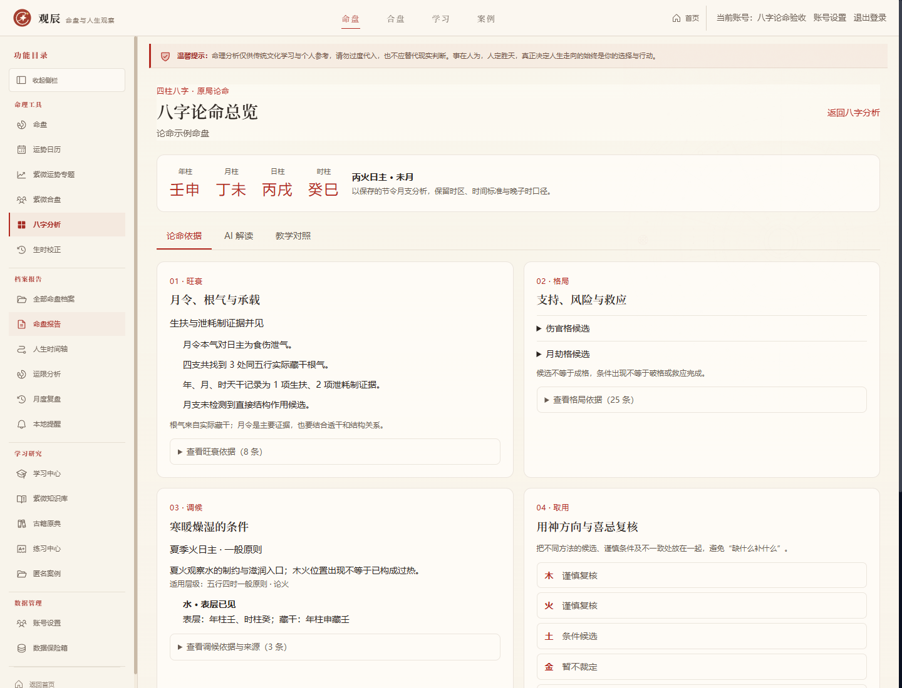
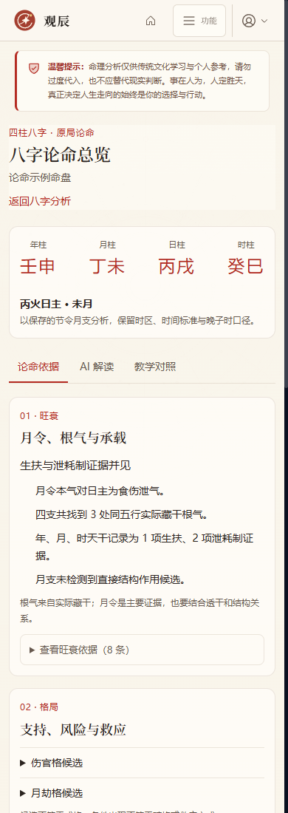

# 八字论命深化第一版实施记录

日期：2026-10-12（UTC+08:00）。这是六模块计划的第三模块，属于账号开发版 1.1.0-dev，尚未发布到 main，v1.0.0 冻结标签保留。

## 用户入口与功能

进入八字分析，打开或保存一份自己的八字命盘，在保存栏点击“八字论命总览”，进入 `/bazi/reading/[id]`。总览分为论命依据、AI 解读、教学对照三个视图，保留当前四柱、日主、月令及排盘口径。

论命依据包含四部分：

1. 旺衰：复用原有月令、实际藏干根气、透干和生扶/泄耗制证据，展示标签、理由及来源。
2. 格局：保留所有月令候选，分别展开支持条件、风险条件、救应候选，不把仅藏未透当成表层条件齐备。
3. 调候：新增五行四时规则、已校核日干月令参考、候选元素的表层/藏干位置及适用条件。
4. 取用：按木火土金水并列月令格局法、扶抑法、调候法的候选与谨慎条件，标明方法需协调、条件候选、谨慎复核和暂不裁定。未知时辰全部降级，不按缺项强行补五行。

AI 解读由用户手动生成，包含旺衰、格局、调候、取用及行动五章，每章引用实际依据。保存后可以重开、切换旧版本，重新生成不覆盖旧版，失败时仍能读已有内容。继续问八字可进入当前命盘的独立会话，并带入同一套新增调候参考。

教学对照提供冬季、夏季、杂气月、未知时辰四个合成例子，与当前命盘并列观察。示例按实际排盘规则计算，不写入账号档案，不记录现实经历，也不用于推导相似命盘的相同命运。

## 本版的规则范围

新增规则版本 `bazi-reading-v1-seasonal-cross-method`，规则来源核对了 [《穷通宝鉴》维基文库原文](https://zh.wikisource.org/zh-hans/穷通宝鉴)。代码将原典的一般原则改写成条件观察，不继承财富、婚姻、健康、寿命或命运断语。

五行四时共 20 条一般原则，通过日主五行与节令月支选择，覆盖十干十二月的 120 个输入组合。这里的覆盖表示每个组合都有明确的适用层级，**不表示已完成 120 条精细调候取用规则**。

已逐项启用的日干月令参考为：甲寅、庚寅、丙卯、辛酉、己戌。分别记录原典章节、候选天干及表层/藏干位置。其余组合明确显示“五行四时一般原则”。其他精细月表、特殊格局、最终身强身弱、最终成格破格、用神喜忌裁决，仍需后续校核；不使用 AI 自行补算这些缺项。

季节按保存命盘的节令月支定位，不按公历或农历月份替代；四柱仍服从原有精确节界、时区、真太阳时和晚子时设置。寒暖燥湿是传统规则语义，不等于出生地的实测天气。日干只作日主参照，不重复当成候选取用的表层位置。

方法协调不生成分数或排名。调候方向与已开放扶抑方向不一致、或同元素同时有候选及谨慎条件时，标记需要协调；暂不能裁定的保留问题。谨慎方向不等于固定忌神，通关病药仍保留原有未启用状态。

## 实现与账号资料边界

- `lib/bazi/climate-rules.ts`：20 条季节规则、五组日干月令参考、版本与来源。
- `lib/bazi/reading-engine.ts`：调候匹配、显隐位置、五行方法矩阵、依据与待核问题；连续问答复用其调候快照。
- `lib/bazi/reading-interpretation.ts`：五章提示词、结构/重复/引用和方法对应校验。
- `lib/bazi/reading-service.ts`：读取自己的已保存八字版本，复用现有旺衰与格局条件审计，生成和保存解读。
- `lib/db/bazi-readings.ts`、SQLite v50：新增 `bazi_reading_versions`，保存完整规则依据、正文、模型、提示版本和用量。每个八字版本最多一个生成中任务，删除八字档案/版本时级联删除。
- `app/api/bazi/charts/[id]/reading`：依据、报告版本、教学例子读取与生成；全部使用 `withAccount`。客户端不能指定其他账号，匿名 401，跨账号 404；示例也先核对当前命盘归属。
- `components/BaziReadingWorkspace`：三个视图、条件展开、版本选择、错误重试和继续问八字；示例切换取消旧读取，生成中可切换视图。
- 八字对话提示版本升级为 `bazi-chat-reading-climate-v18`，已有会话按原更新机制补入当前版本。

报告缓存指纹包含规则与依据，但排除计算时间，避免每次读取造成无意义的新报告。AI 最多 100 秒；占位超过 150 秒可恢复，任务令牌与状态限制迟到结果。失败只存固定错误码，客户端固定中文提示，不回显上游配置。新表随整库备份恢复；八字资料继续保持独立边界，不混入紫微单盘包。

业务库在重新打开时从 v49 自动升级 v50，既有八字、日历及紫微专题保留。旧备份和单盘包保持严格版本匹配，使用对应旧版还原后升级；冻结 v1 库结构仍为 v47。

## 验收

- 专项 182 项通过：120 个规则输入组合、五组精细参考、节界、显隐、时辰未知、方法不一致、四个例子、五章及引用、缓存/版本、失败脱敏、并发/过期/迟到、账号边界、级联删除、备份恢复和迁移。
- 全项目检查最终 82/82 通过。日志与最终机器结果见 [验收证据](./qa-evidence/2026-10-12-bazi-reading.json)。
- 开发与生产版浏览器检查包含依据、五行条件、报告生成/保存/旧版、失败重试、教学例子、快速切换、未知时辰、既有档案入口，以及实际匿名/跨账号/跨站写入拒绝。
- 浏览器共 26 项通过；生产版“继续问八字”带入草稿、收到并保存模拟回复，实际供应商请求包含新增调候快照，对话使用 v18 提示版本。
- 三个视图各在 1440/1280/1024/768/390/320 像素检查，18 组结果无文档横向溢出；axe WCAG 2 A/AA、2.1 AA 自动违规为 0。
- 类型检查与生产构建通过，80 个静态页面生成成功；新页面与接口为动态路由。

首次全量检查发现校时方法声明和专项仍写死旧运限版本，现统一引用当前引擎，业务快照复测通过。首次生产构建发现测试数据的字典类型不够明确，改成显式四柱结构后通过。

后续全量复核发现 PDF 孤儿文件清理的偶发时间精度问题：文件修改时间可能略晚于毫秒时钟，默认无等待期的清理被错误跳过。现仅在配置正等待期时检查年龄，新增时间偏差复现与等待期保护测试并通过；文件路径和账号边界保持原检查。

所有测试账号、出生资料和教学例子均为合成数据，AI 供应商由本机模拟。功能与保存链路验收不等于真实模型解释质量验收，真实解读仍需实用核对。

下一模块为紫微与八字合参。本模块的精细规则校核作为后续增强继续保留，不宣称已完成全部传统论命流派。

## 后续深化状态

2026-10-15月令与条件复核已扩展：120组来源分层索引、具体用干根气、五合根冲及特殊格局入口；报告和对话版本同步。以上五组参考等描述属于第一版交付历史，最新范围和边界见 [精细论命实施记录](./BAZI_FINE_READING_IMPLEMENTATION.md)。
