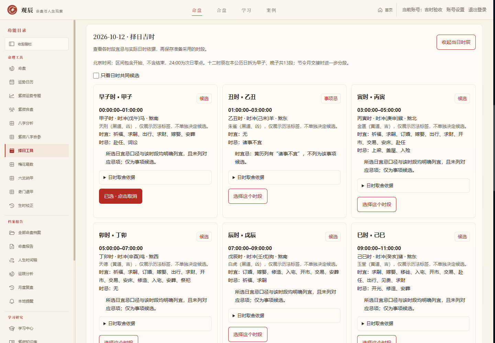
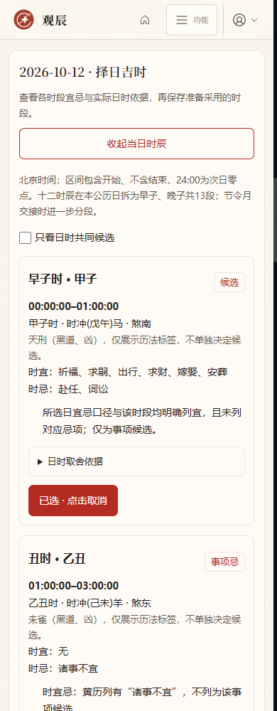
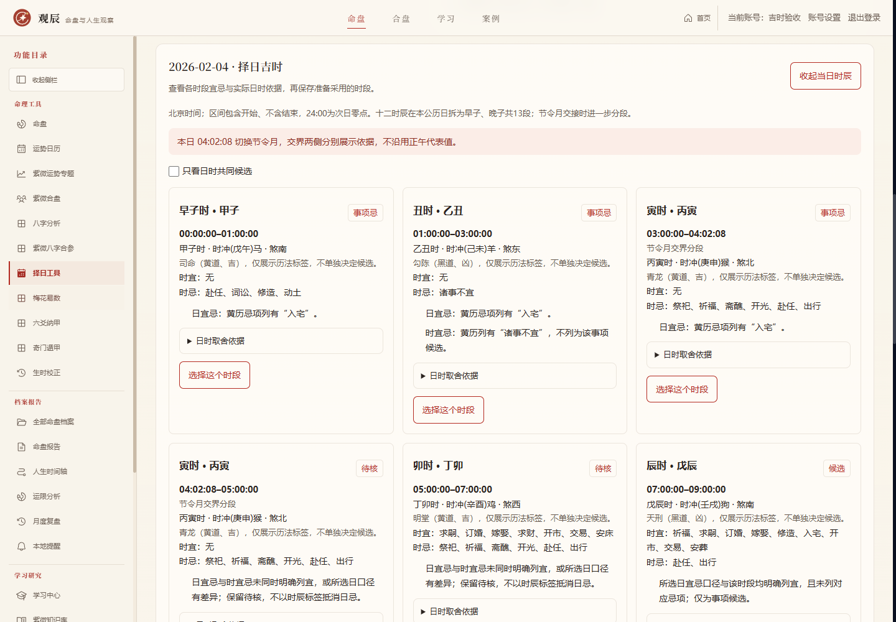

# 择日吉时实施记录

开发日期：2026-10-13（UTC+08:00）。用户在原六个命理模块的第一版基础完成后，选择继续开发择日吉时。本阶段属于 `1.1.0-dev`，沿用 `/election` 及已有方案详情入口。

## 用户流程

先按事项与日期区间筛选，选择日期后点击“查看当日时辰”。展示各时段干支、时宜忌、时冲、煞方、值神与日时取舍依据，可切换“只看日时共同候选”。最多保存三个时段，日期对照另外最多三个，两者互不占用。允许保存待核或不宜时段供现实安排复核，但不会把原始状态改成吉时。

保存、刷新、重新登录后读取原有时段快照。改变筛选条件会清空尚未保存的时段；已保存方案重新筛选会另建方案。时辰查询按需发起，不生成整段区间全部时辰，不调用AI。

## 历法来源与边界

规则直接读取项目实际安装的 `lunar-javascript 1.7.7`，参考 [作者源码](https://github.com/6tail/lunar-javascript/blob/v1.7.7/lunar.js) 的 `getTimeYi`、`getTimeJi`、`getTimeTianShen`、`getTimeChongDesc` 等方法。依赖固定为1.7.7，锁文件版本未更换。本轮修正新择日结果的旧版本标签与来源链接（原标签写1.7.3，实际依赖已为1.7.7）；已保存旧方案快照不会重写。

- 北京时间标准时，1900–2100年，与原择日区间保持一致，最多92天。宿主系统时区不参与日期计算。
- 十二时辰在一个公历日内拆成13段：早子00:00–01:00、丑01:00–03:00，依次至亥21:00–23:00、晚子23:00–24:00。区间包含开始、不含结束，24:00表示次日零点，不冒充当天24点的有效起始时刻。
- 日宜忌沿用库的公历日口径；时宜忌、时干支和值神采用库的23点子初换日。晚子时展示两个日干支，日时界不同的时段保留待核；已有忌项或用户条件排除仍优先。第一版不额外提供可切换的午夜时宜忌表。
- 精确节令月在日内改变时，二分定位到实际交节秒界，再切分相应时辰。每段取自身起点的月干支与日宜忌。交节日期口径仍显示供对照，不混成一套流派。
- 判断顺序：用户星期／日冲排除 → 日或时明确列忌（含诸事不宜）→ 晚子口径差异待核 → 所选日口径与时段均明确列宜才为候选。仅一侧支持或日口径不一致保留待核，未列事项不等于适宜。
- 黄道／黑道与值神标签仅展示，不用于改写候选；没有吉凶打分、自动排名或事项成功率。日冲条件仅用于日冲，时冲单独展示，不暗中追加筛选。
- 不含个人八字喜忌、真太阳时、三合等专门择日，不保证现实结果。该库原始数据的一致性核对不等于独立天文历算或完整传统流派验证。

已知案例：2026-10-12己未日早子甲子时，时宜列嫁娶，值神天刑；即使标为黑道，只要所选日时规则都明确支持，仍按事项列为候选。该日丑时“诸事不宜”排除。晚子使用庚申日丙子时，时宜忌与次日早子一致，但与本公历日日宜忌存在日界差异，标为待核。2026-02-04立春04:02:08在寅时中途交接，将03:00–05:00分为两段，分别核对己丑／庚寅节令月。

## 接口与保存

- `POST /api/election/hours`：提交现有筛选 `input` 与区间内 `date`，返回单日完整时段及版本来源。登录后可查询，不写入数据库。
- 创建／修改择日方案时增加 `selectedTimes: [{date, slotId}]`，最多三项。客户端不能提交盘面快照、伪造状态或来源；服务器重新计算新选择并验证时段标识。
- 已保存且保留的时段沿用原快照；改名称、备注或日期对照不会改变其规则结果。变更条件需要重新筛选，时段ID失效时拒绝保存并提示重查。
- 数据库升级至v56，`election_plans.selected_times_json`保存所选时段与其日时依据，旧方案默认为空。删除方案一起删除时段；整库备份包含该列，单紫微命盘包不包含独立择日方案。
- 全部接口沿用账号隔离、私有不缓存与同源写入检查；读写其他用户方案返回404，匿名返回401。旧v55及更早备份先由对应版本恢复，再升级当前代码。

## 验收

2026-10-13验收完成：

- 择日吉时专项1005项断言通过，覆盖六十日各时段、日时判断组合、实际交节秒界、早晚子跨日、日期边界、时区独立、数量／重复／越界／伪造拒绝、固定快照、v55到v56旧数据保留、备份恢复与账号隔离；既有择日专项158项通过。
- 全项目88/88组回归通过，生产构建通过，类型检查通过。
- 网页34项功能安全检查通过，包括入口、时段显示、候选与空结果、上限、保存刷新、备注不重算、取消选择、复筛、交节分段、快速切换防串数据、故障重试、删除、匿名／跨账号／同源与伪造拒绝。全流程AI调用0次，页面运行错误0项。
- 时段列表、保存依据、交节分段3种视图×6种宽度（1440、1024、820、768、390、320）×2种主题偏好，共36组无横向溢出；axe所选WCAG 2 A/AA和2.1 AA规则未发现违规。沿用工作台现有纸色外观，主题偏好兼容不表示本轮新增全局深色皮肤。桌面及手机截图已人工查看；响应式模拟不代替实际设备测试。
- 未提交、推送或更改远程版本标签，继续保留1.1.0-dev身份。

证据：[网页功能与布局](./qa-evidence/2026-10-13-election-hours-browser.json)、[全量回归](./qa-evidence/2026-10-13-election-hours-regressions.json)。

