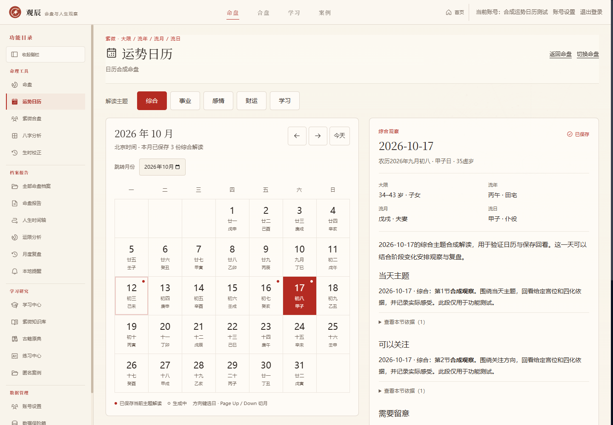
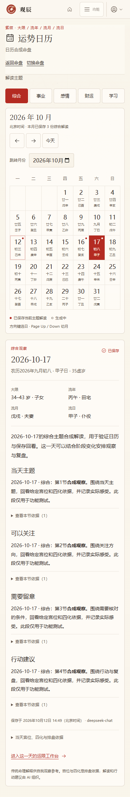

# 运势日历第一版实施与验收

日期：2026-10-12（UTC+08:00）。对应 [当前命理开发计划](./DIVINATION_DEVELOPMENT_PLAN.md) 的第一模块。

## 使用入口与范围

工作台左侧“命理工具 → 运势日历”。未打开个人命盘时先进入 `/chart/select?target=calendar` 选择自己的命盘；已有个人命盘上下文时直接进入 `/chart/<id>/calendar`。首页和命盘功能菜单也提供入口，合盘及校时上下文不会被误作个人命盘。

月历按公历月展示，附农历日期与日干支。今日固定为北京时间；支持前后月、月份输入、回到今天、点击日期与键盘选日。方向键移动一天或一周，Home/End 移动到周首/周末，Page Up/Down 切换月份并恢复日期焦点。选中日期及主题保留在 URL，刷新可以恢复。

选中日展示实际大限、流年、流月、流日和农历虚岁，复用 `lib/transits` 的流日引擎。春节换岁、农历月界和闰月遵循原规则，不用年度年中代表日替代所选日。未知出生时辰显示子时试排提示。页面提供完整宫位、四化、流曜依据及进入当日运限工作台的链接。

五类主题为综合、事业、感情、财运、学习。点击后生成摘要与四节解读，每节可以展开其引用依据。读取月历、切换主题与回看保存内容不调用 AI。月历标记当前主题已保存的日期，避免将不同主题的保存状态混用。

## 实现与数据边界

- `lib/fortune-calendar`：北京时间日期工具、主题与结果类型、月历/当天服务、事实与提示词、章节及引用校验。
- `lib/db/fortune-calendar.ts`：解读保存、生成占位、过期恢复、任务令牌与原子提交。
- `app/api/conversations/[id]/calendar`：读取月历或当天详情；`calendar/readings`：按指定日期及主题生成。
- `components/FortuneCalendarWorkspace`：月历、主题选择、当天运限、解读和依据；复用现有安全 Markdown 渲染器。
- SQLite v48：新增 `fortune_calendar_readings`，按命盘/日期/主题唯一，并保存完整生成依据、模型、提示版本及用量。删盘级联删除；整库备份和单命盘包包含解读。
- 两个 API 均使用 `withAccount`。用户身份来自会话；请求体中的 userId 不改变归属。匿名拒绝、跨账号 404；管理员同样不跨账号读取业务资料。
- 同日期同主题的并发请求复用已开始的任务；生成超时为 100 秒，占位超过 150 秒后可恢复。令牌校验阻止旧任务覆盖新重试。供应商错误只保存固定错误码并返回固定中文提示，不保存或回显上游敏感内容。
- UI 读取与生成均校验当前选择，取消旧请求，避免切换日期/主题后出现旧内容；恢复任务会按 2.5 秒间隔读取状态。

已有用户库首次重新打开时迁移至 v48，v47 到 v48 保留既有命盘的场景已在临时库测试。旧 v47 归档仍遵循原有版本匹配要求，冻结 v1 标签保持原结构。

## 验收结果

- `npm run test:fortune-calendar`：最终 63 项通过，含 UTC/北京时间跨日、公历闰年、出生与上限日期、春节换岁、农历月界、闰月、保存重开、主题隔离、供应商失败与重试、无效章节/引用拒绝、并发/过期/迟到响应、账号边界、升级迁移、单盘迁移和整库恢复。
- `npm run test:v1-all`：新增日历专项后 80/80 通过。日志目录为 `C:/Users/11474/AppData/Local/Temp/guanchen-v1-checks-cVWvn3`；后续空日期拒绝的补测纳入上述最终 63 项。
- 独立开发及生产服务使用系统临时账号库和合成出生资料，仅 AI 供应商由本机模拟。实际浏览器完成五个主题生成、刷新保存、主题缓存、引用展开、月份切换、今日定位、出生日期/上限约束、方向键和跨月焦点、失败重试、延迟请求与生成时切换、书签恢复、选盘导航、未知时辰提示、匿名与跨账号 HTTP/页面隔离。
- 最终生产版在 1440、1280、1024、768、390、320 像素宽度检查：文档横向溢出为 0；axe WCAG 2 A/AA、2.1 AA 自动违规为 0；生产版操作无页面脚本异常。发现并修正了全局侧栏折叠后返回首页链接的无障碍名称。
- 类型检查和独立生产构建通过，80 个静态页面生成成功，新页面与接口按动态路由提供。

首次延迟响应测试用了错误的手写日干支预期，改为读取同一日的权威快照后复核通过；页面没有日期串用。闰月名称重复和跨月焦点提前清空的问题已修正并复测。

机器结果见 [验收证据](./qa-evidence/2026-10-12-calendar.json)。页面截图使用合成资料和本机模拟解读，不能代表真实 AI 内容：

## 验收限制

启动使用真实模型配置的独立验收服务被自动审批拒绝，仅返回 `blocked by policy`，没有更具体原因。已采用本机模拟供应商完成生产版功能验收，本轮没有宣称真实 DeepSeek 日历解读内容质量通过。模拟视口也不等同于实体手机验收。

第一版不含八字日历、跨月专题比较或择日排序，这些按当前计划的后续模块推进。章节完整性与引用存在检查不能证明每一句命理解释都由引用支持。
