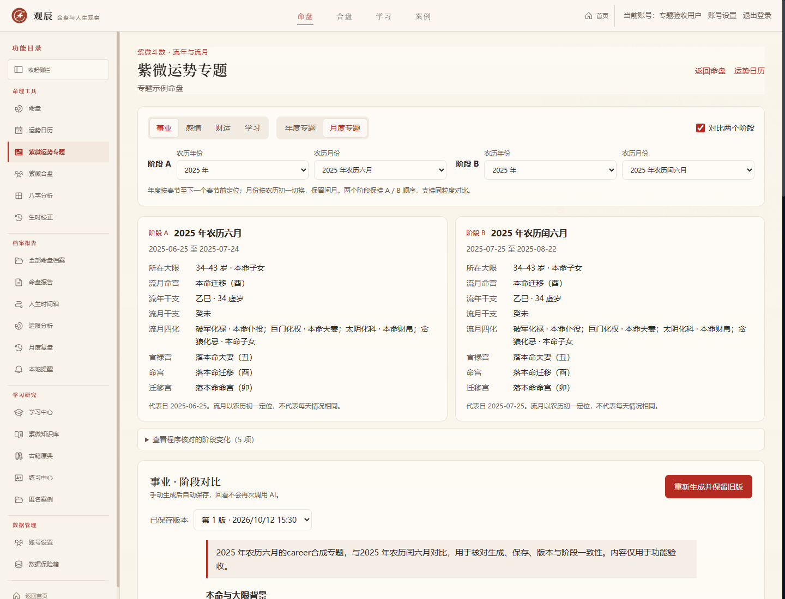
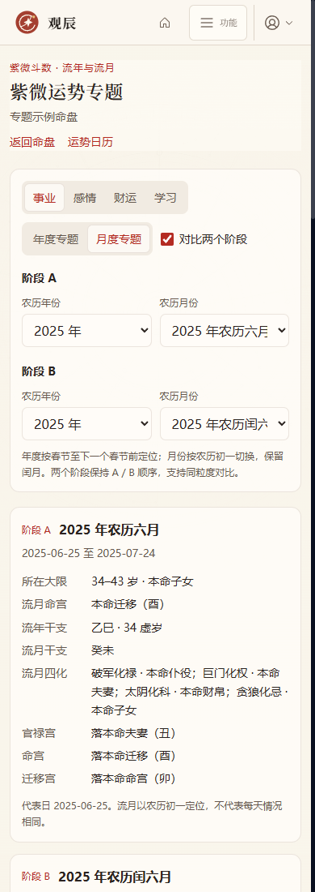

# 紫微运势专题实施与验收记录

日期：2026-10-12（UTC+08:00）。本阶段为六模块计划的第二模块，当前账号开发版 1.1.0-dev；尚未发布到 main，不改变 v1.0.0 冻结标签。

## 使用范围

首页模块区、工作台侧栏、命盘功能菜单和本命报告中心提供“紫微运势专题”入口。无命盘上下文时先选择当前账号的个人命盘，有上下文时进入 `/chart/[id]/fortune`。

支持事业、感情、财运、学习四个主题，按农历流年或真实农历月分析。年度为春节至下一个春节之前；月份保留闰月，普通六月和闰六月分别可选。页面展示公历起止日期，出生日期和运限上界截取实际可分析范围。历法年份为 1900–2200，命盘自身范围不超过出生公历年加 130 年或 2200 年。

单阶段报告包含本命与大限背景、阶段观察、条件提醒、行动安排四节；开启对比后增加阶段 B 观察、阶段 B 提醒和两阶段异同，共七节。仅允许两个不同年份或两个不同农历月份对比，保留 A/B 顺序。事实预览、宫位映射、四化、专题宫位三方四正及程序对比不调用 AI。没有新增吉凶分数或强行排名。

生成由用户手动触发，自动保存；回看、刷新和读旧版本不再次调用 AI。重新生成保留旧版，失败仍可读取已完成版本。历史区提供最近 50 份专题，点击恢复主题与阶段；书签保存主题及两个阶段。每节可展开对应版本的依据，使用现有安全 Markdown 渲染器。

## 实现与资料隔离

- `lib/fortune-topics`：阶段标识与农历范围、单阶段/对比事实、提示词、正文及引用校验、生成服务。
- `lib/db/fortune-topics.ts`：报告系列及版本、任务占位、过期恢复、令牌校验和原子发布。
- `app/api/conversations/[id]/fortune-topics`：选项/预览/历史版本读取、生成和重新生成。全部使用 `withAccount`；客户端不能切换归属，报告 ID 同时检查命盘归属。
- `components/FortuneTopicsWorkspace`：筛选、双阶段预览、依据、版本和历史。取消旧读取并核对选择，生成时切换不串结果；读取生成中任务每 2.5 秒更新。
- SQLite v49 新增 `fortune_topic_reports`、`fortune_topic_versions`；同命盘/主题/A/B 唯一，一个系列最多一个生成中版本；删盘级联删除。单盘包包含两表并重新映射当前版本软引用；整库备份包含全部版本。

AI 调用最多 100 秒，任务占位超过 150 秒可恢复；迟到响应必须匹配任务令牌与生成中状态，否则不发布。供应商失败只保存固定错误码，客户端返回固定中文提示，旧正文不覆盖。输出章节完整且不重复；引用必须实际存在，A/B 章节不能互相串用，比较节必须同时引用两阶段，本命背景须引用本命和阶段 A 大限。

时辰未知时明确标注子时试排。年度代表日期默认年中，并夹取到实际分析范围，春节前出生可选择出生所在的上一农历年；月度复用农历初一定位规则。代表日不是全年或整月逐日预测。缺少大限依据时不补造大限。

## 本次发现并修正的底层边界

原运限引擎仅按宫位关联大限，童限可能关联同宫位的晚年年龄段；超出十二个已排大限时，供应库返回下标 -1，直接访问会报错。现同时检查宫位与年龄范围，区分童限、大限和超出已排大限；年度、月度、流日三层均已修复，并为新快照升级引擎版本，避免复用旧规则缓存。历史报告依据仍按生成时快照保留。

供应库的宫名常为“官禄”“夫妻”，项目专题配置使用“官禄宫”“夫妻宫”。主题映射现统一比较宫名，避免专题宫位返回 -1。原年度运限页面仍使用 7 月 1 日代表口径；新增按观察日计算的年度函数供本模块处理出生边界。

## 验收结果

- 专项 94 项通过：农历年界、闰月、出生/末年、童限/缺少大限、四主题、双阶段与顺序、章节引用、缓存/旧版本、失败脱敏及重试、并发、过期/迟到结果、匿名/跨账号/跨命盘、迁移、单盘包与整库恢复。
- 全项目检查 81/81 通过，日志 `C:/Users/11474/AppData/Local/Temp/guanchen-v1-checks-3PQhaC`；后续宫名归一、引擎缓存版本调整后，年度/月度/全年流月/流日/日历及本模块专项均再次通过。
- 实际浏览器操作 22 项通过，含四主题、年度对比、普通/闰月对比、失败保旧、版本切换、刷新不调用、引用展开、生成中切换、历史恢复、选盘入口及生产版边界。
- 实际 HTTP 验收：匿名 401，跨用户读取/版本/生成 404，跨站写入 403。
- 独立生产构建及类型检查通过，生成 80 个静态页面；新工作台与接口为动态路由。
- 最终生产版 1440/1280/1024/768/390/320 像素：无文档横向溢出，axe WCAG 2 A/AA、2.1 AA 自动违规为 0，生产版操作未出现页面脚本异常。

证据见 [机器验收结果](./qa-evidence/2026-10-12-fortune.json)。所有验收资料为合成数据，AI 由本机模拟；这些检查证明功能与保存链路，不等于真实 DeepSeek 解释质量验收。真实内容仍需在实际使用中核对。

## 升级与后续

用户业务库在重新打开时从 v48 自动升级 v49，既有命盘和日历资料保留。旧 v47/v48 备份和单盘包继续遵循严格版本匹配，使用对应旧版本还原后再升级，不能直接冒充 v49 归档。

本模块完成后，第三模块为八字论命深化，按计划另行推进。
