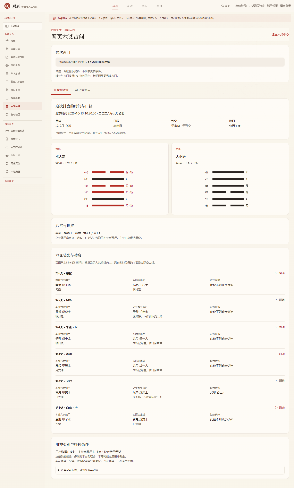
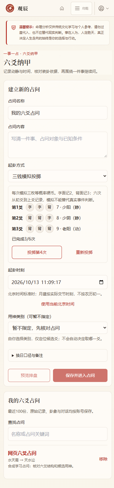
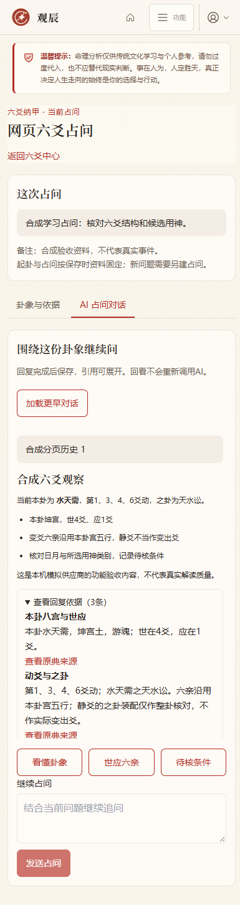

# 六爻纳甲实施记录

本文保留2026-10-13第一版交付记录。2026-10-15已继续交付用神与月日动变条件复核，新能力、兼容策略及验收见 [六爻深化实施记录](./LIUYAO_READING_IMPLEMENTATION.md)。

开发日期：2026-10-13（UTC+08:00）。第六模块的第二阶段，在梅花易数之后实施六爻纳甲第一版。入口 `/liuyao`，首页与侧栏均提供入口；当前属于 `1.1.0-dev`，奇门尚未开发。

## 第一版范围

支持手动录入六个6/7/8/9，或逐次三钱模拟投掷。保存单件占问、名称、备注、北京时间、显式换日口径、用户选择的用神类别与原始记录。可先预览再保存；预览不建档、不调用AI。默认手动值仅为选择初值，不代表已完成真实起卦。

六爻记录从初爻向上，页面卦画从上爻向下。6为老阴、7为少阳、8为少阴、9为老阳；6和9翻转，支持零至六个动爻。三钱字面记2、背面记3，浏览器使用密码学随机字节逐枚取二进制正反面，八种三钱组合的四象分布为1:3:3:1。模拟记录不冒充真实硬币结果。

展示本卦与之卦、八宫与游归魂阶段、本卦世应、纳干支五行、六亲、六神、月建日辰、旬空和缺亲伏神。用神类别由用户选择，定位本卦及伏神的候选爻；未选择或多现时不自动裁定。

## 文献与计算口径

依据 [《古今图书集成》所收《卜筮全书》三钱、五行六亲](https://zh.wikisource.org/wiki/Page:Gujin_Tushu_Jicheng,_Volume_466_(1700-1725).djvu/33)、[八宫与世应](https://zh.wikisource.org/wiki/Page:Gujin_Tushu_Jicheng,_Volume_466_(1700-1725).djvu/34)、[六神与纳甲](https://zh.wikisource.org/wiki/Page:Gujin_Tushu_Jicheng,_Volume_466_(1700-1725).djvu/35)，并用 [《易汉学》卷四八卦六位图](https://zh.wikisource.org/wiki/易漢學_(四庫全書本)/卷4) 核对上下卦纳甲方向。扫描转录可能有错字，数据以交叉核对后的干支表为准。

- 八宫从八纯卦依次变初至五爻、返变第四爻成游魂，再返变内三爻成归魂。世爻顺序6/1/2/3/4/5/4/3，应与世隔三位。64卦全部有唯一归宫，独立古籍列表用于测试核对。
- 内外三画卦分别纳甲；乾内甲外壬，坤内乙外癸，其余采用各卦纳干。地支五行用于判定六亲，以本卦宫五行为“我”。生我父母、同我兄弟、我生子孙、我克妻财、克我官鬼。
- 之卦的六亲仍按本卦宫五行计算，依据 [《增删卜易》动变章](https://zh.wikisource.org/wiki/增刪卜易/7)。只在原动爻位置比较实际变出爻，静爻位置的之卦装配明确标注为整卦核对，不能当成动爻。原典“水天需之天水讼”用作多动爻独立核对例。
- 六神以所选日干从初爻向上循环，甲乙青龙、丙丁朱雀、戊勾陈、己螣蛇、庚辛白虎、壬癸玄武。页面玄武对应古籍的元武。
- 缺亲伏神只将本卦未出现的六亲从本宫八纯卦同位取出；不自动裁定飞伏生克和有用无用。八纯互宫取伏等其他传统口径不混入本版，姤卦二爻伏财寅木作为独立核对例。
- 历法使用项目既有 `lunar-javascript` 的实际交节时刻；年界立春，月界十二节，保留北京时间标准时1900–2100年、秒精度。日界默认公历午夜，也可显式选择23点子初；日干支、六神与旬空一起随该选择变化，不做真太阳时校正。
- 旬空按六十甲子所在十日旬缺少的两地支求得，依据 [《增删卜易》旬空章](https://zh.wikisource.org/wiki/增刪卜易/26)。临月建、临日辰、月支冲、日支冲仅作相同或相对地支关系标记，不把标签直接写成吉凶、真空假空、暗动或日破。

## 独立会话与数据安全

每份占问固定起卦资料，保存后可以继续追问；改变起卦应另建记录，避免历史回复的依据改变。沿用既有账号身份验证、同源写入保护与安全Markdown展示。匿名拒绝，跨账号读写停止删除均拒绝，响应为私有且不缓存。服务端重新计算并忽略客户端伪造卦象、账号字段。

AI只接收当前固定占问、结构依据及最多八轮已完成历史；输出必须引用1–8条已有依据。第一版整段生成后展示，不宣称逐字流式。支持停止、失败重试、请求幂等、同会话单轮生成、100秒上游超时与150秒过期恢复，迟到响应不能覆盖停止或过期状态。分页每次30轮，可加载更早历史。模型提示明确区分六爻与梅花体用，不混入八字、奇门或未实现的断法；规则校验不代表真实内容质量已核验。

数据库升级至v54，新增 `liuyao_sessions`、`liuyao_turns`。按账号独立保存，删除占问先停止生成再级联删除对话。完整数据库备份包含六爻占问与对话，单紫微命盘包不包含独立六爻记录。旧v53及更早备份须在兼容代码下还原后升级，不直接按v54包导入。

## 边界与验收

第一版为可复核的六爻装卦与依据问答，不包含自动取用、精细旺衰、暗动、进退神、反伏吟裁断、墓绝、三合成局、应期或确定性吉凶结论；没有把这些尚未实现的条件交给AI自行编造。完整卦辞爻辞文本未内置，不允许模型伪造原文。

验收已完成。专项覆盖64卦×64动爻组合、三钱分布、独立八宫纳甲列表、原典多动起例、旬空六十日、交节秒界、晚子时、非法输入、幂等并发、停止重试、迟到恢复、分页、账号隔离及整库备份。网页链路使用独立临时账号和本机模拟AI，真实内容质量与真实设备验收另行核对。

| 检查 | 结果 |
| --- | --- |
| 六爻专项 | 16649项断言通过，包括4096种本卦与动爻组合的结构核对，以及日月、三钱和保存生命周期 |
| 全量回归 | 86/86组通过；随后补充的请求编号兼容及升级保留梅花检查也已通过专项复测 |
| 构建与类型 | 独立生产构建通过，实际生产服务访问通过；TypeScript检查通过 |
| 网页功能安全 | 54项通过，包括三钱、六动及四动原典示例、显式换日、缺亲候选、Markdown、依据、停止重试、37轮历史回看、删除确认、匿名和跨账号拒绝、同源与缓存隔离、HTML转义、异常恢复及生成中删除 |
| 响应式与无障碍 | 中心、投掷、预览、装卦、聊天五视图×1440/1024/820/768/390/320六宽度，共30组，无横向溢出，axe的WCAG 2 A/AA与2.1 AA标签检查无违规 |
| 局域网请求兼容 | 缺少浏览器randomUUID时仍用密码学随机字节生成标准请求标识，实际网页发送保存通过；不等同真实其他设备已验收 |

[浏览器逐项记录](./qa-evidence/2026-10-13-liuyao-browser.json) · [全量回归概要](./qa-evidence/2026-10-13-liuyao-regressions.json) · [服务与交付核对](./qa-evidence/2026-10-13-liuyao-delivery.json)

交付时独立验收应用与模拟供应商已关闭，常用开发服务继续在 `http://localhost:30001` 运行，监听 `0.0.0.0:30001`。登录页返回200，未登录访问六爻页面跳转登录，匿名六爻接口返回401。合成资料只保留在独立临时目录，不进入正常账号库；本次未更新远程仓库或创建新标签。

截图已人工查看；合成占问与模拟AI文本只用于功能和排版核对，不作为真实预测质量或全部无障碍要求的结论。

