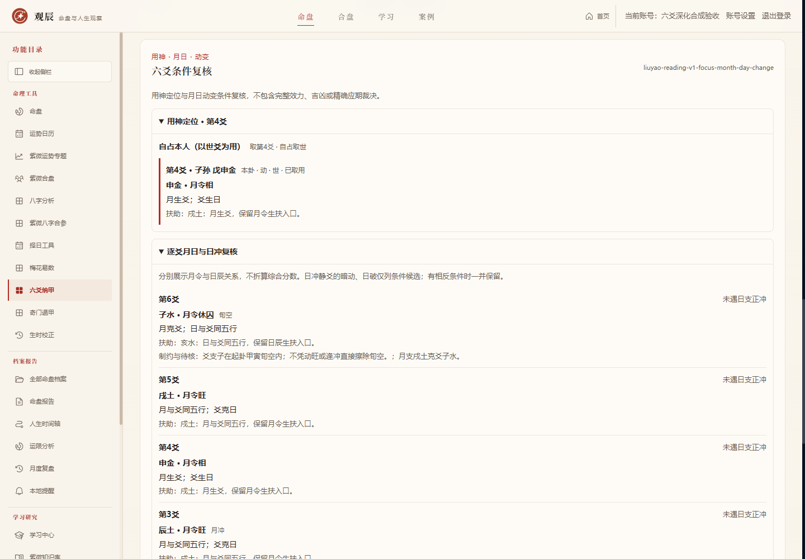

# 六爻深化：用神与月日动变条件复核

后续阶段见 [六爻用神与作用路径条件复核（2026-10-16）](./LIUYAO_INFLUENCE_IMPLEMENTATION.md)。本文保留上一版条件复核的能力与验收记录。

本轮承接个人化择日，交付已确认深化顺序的第三项。入口仍为 `/liuyao`，数据库保持v56；本阶段不进入奇门深化。代码和验收资料保留在本地，未推送或合并远程。

## 本阶段能力

新建占问可明确选择自占本人、父母长辈、文书证件、兄弟同辈、子女晚辈、求财财物或功名职务，也可自行选择六亲。自占取本卦世爻；其余模板映射对应六亲。程序不从自由占问文本猜测对象。类别只有一个候选时自动定位，多现时并列候选；用户可指定实际候选的1至6爻位，服务端同时核对本爻、伏神和世爻条件。错误位置不会被悄悄改成另一个爻。

排盘新增“六爻条件复核”面板，显示以下依据：

- 逐爻月令旺、相、休囚参考，以及独立的日辰生克、月日六合／正冲、旬空与月破关系。日月扶助和制约并列，不合成强弱分数。
- 静爻被日支正冲时，区分暗动候选、日破候选或空破／动扶待核。动爻日冲只列动散待核，不称暗动，不改原始四象及本变卦。
- 仅实际明动爻比较本位变爻，展示回头生克、比和、原生变泄、原克变耗及进退神支对。变爻不跨位作用其他爻。
- 缺亲伏神的月日条件和飞伏生克关系，不凭存在就判出伏或有效。
- 相对所选用神五行的同类、元神、忌神、仇神与其他类别，分别注明本爻／伏神、明动／静爻；类别不代替生克效力。
- 已定位用神的值支、出旬、冲空、出月填破或冲合观察条件。未定位具体爻时不混合多个候选的应期；本阶段不生成确定公历发生日期。

## 规则来源与保留条件

规则版本为 `liuyao-reading-v1-focus-month-day-change`，基础纳甲装卦版本仍独立保留。依据《增删卜易》结构规则实现，不继承原典的确定性断语、人物评价或病情推断。

| 内容 | 来源与实现范围 |
| --- | --- |
| 用神与多现 | [用神章](https://zh.wikisource.org/wiki/增刪卜易/8)、[两现章](https://zh.wikisource.org/wiki/增刪卜易#兩現章第三十二)：用户明确对象后定位类别，多现不按旺衰或动静排序自动择一 |
| 元忌仇 | [用神元神忌神仇神章](https://zh.wikisource.org/wiki/增刪卜易/9)、[效力条件章](https://zh.wikisource.org/wiki/增刪卜易/10)：生用为元、克用为忌、克元生忌为仇，类别与实际效力分离 |
| 月令 | [四时旺相章](https://zh.wikisource.org/wiki/增刪卜易/15又)：同月支五行为旺参考、月所生为相，其余休囚；辰戌丑未按土月，不冒充人元司令细分 |
| 月破与日冲 | [月将章](https://zh.wikisource.org/wiki/增刪卜易/16)、[日辰章](https://zh.wikisource.org/wiki/增刪卜易/17)、[暗动章](https://zh.wikisource.org/wiki/增刪卜易/22)：保留日扶、空破、动扶反证，不以月令休囚单条件裁定日破 |
| 动变 | [动变生克冲合章](https://zh.wikisource.org/wiki/增刪卜易/15)：回头方向从实际变爻到本位原动爻，不作用别位 |
| 进退 | [进神退神章](https://zh.wikisource.org/wiki/增刪卜易#進神退神章第二十九)：进神七对为亥→子、寅→卯、巳→午、申→酉、丑→辰、辰→未、未→戌；退神反向，不添加戌→丑循环 |
| 空与应期观察 | [旬空章](https://zh.wikisource.org/wiki/增刪卜易/26)：保留原起卦旬空，动旺、值冲与出旬仅列复核条件，不自动解除空破或确定应验日 |

暗动和日破采用本阶段已实现条件的保守候选，不是完整传统断法裁决树。三合、墓绝、反伏吟、全部生克效力、复杂取用争议及精确应期仍需后续校核。月日生克、动变和飞伏的关系存在，不等于事件将按某种结果发生。

## 快照、问答与安全

新复核保存于原 `result_json` 的可选 `reading` 字段，相关依据使用 `reading:` 前缀并与占问一同保存。旧记录读取不会补算新规则、追加新依据或重写旧对话，页面明确显示第一版固定快照。普通读写、整库备份、恢复和账号隔离沿用现有实现，不引入新迁移。

新问答使用 `liuyao-chat-v2-conditional-reading` 提示，消费当前固定复核与依据；旧记录使用旧能力边界，不能把当前复核套给旧盘。输出仍须引用实际存在的1至8条依据，错误引用和确定性断语不发布；停止、重试、幂等和历史分页保持原流程。

客户端只提交原始记录、明确对象及可选爻位，服务端重算，不能用伪造结果或账号字段覆盖。继承属性名、非法模板、非整数爻位和非候选爻位均拒绝。修改条件时取消旧预览请求，迟到结果不得覆盖新表单；保存时锁定提交。所有业务访问使用当前账号数据库、私有不缓存响应及同源写入校验。

## 验收

2026-10-15（UTC+08:00）使用独立临时账号与数据库完成验收，不读取正式档案。

| 检查 | 结果 |
| --- | --- |
| 新增六爻条件复核专项 | 79,320项通过 |
| 原六爻专项 | 16,649项通过 |
| 全项目回归 | 91/91组通过 |
| 生产构建与类型检查 | 通过 |
| 网页功能安全 | 50项通过 |
| 五视图六种宽度的布局与自动无障碍 | 30组通过，无横向溢出，所选WCAG 2 A/AA与2.1 AA检查无违规 |
| 模拟供应商 | 5次请求：新快照4次（含停止、失败及重试）、旧快照1次；策略与快照对应，真实供应商0次 |

新增专项包含独立五行／支对矩阵、4,096种真实本卦动变组合、用神模板与手动定位、月破旬空及日扶动扶反例、旧快照、备份和API所有权。网页还验证了预览迟到取消、缺亲伏神、三钱、晚子换日、新旧问答引用、停止重试、回看不重调AI、原型键拒绝、跨账号及同源保护。

[网页逐项与布局证据](./qa-evidence/2026-10-15-liuyao-reading-web.json) · [全量回归记录](./qa-evidence/2026-10-15-liuyao-reading-regression.json)。浏览器模拟及本机AI功能验收不替代真实设备、真实AI表达质量或完整传统规则适用性验收。

