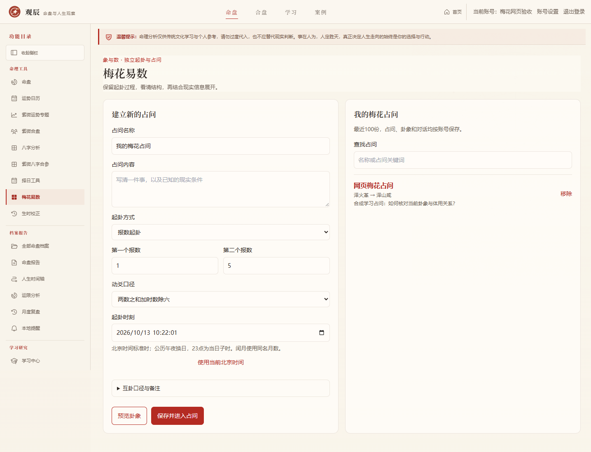
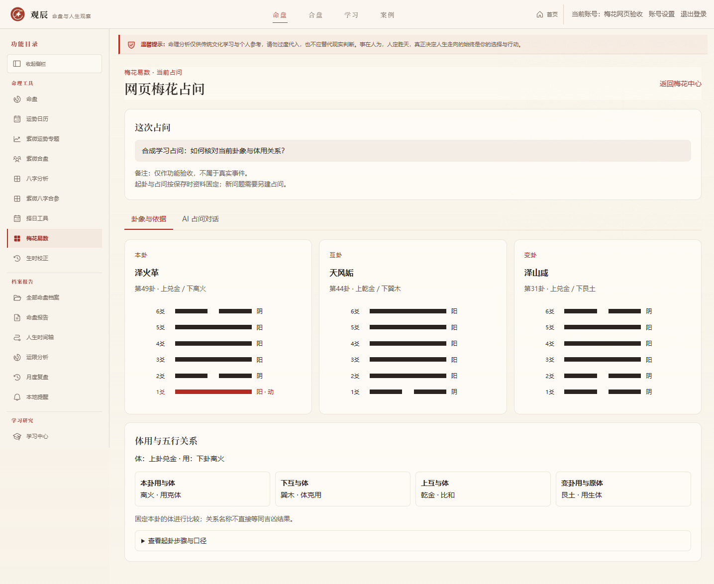
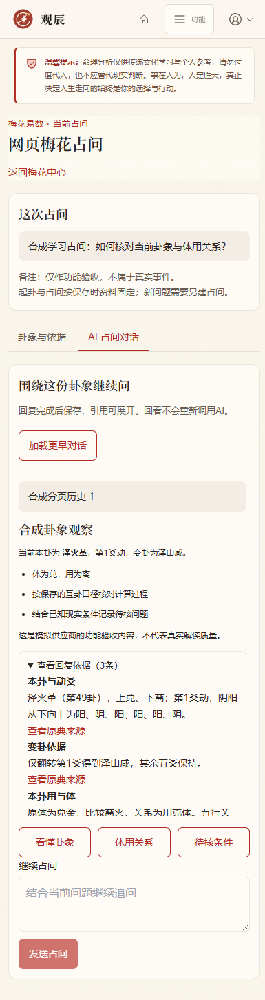

# 梅花易数实施记录

后续进展：已增加物数起卦、季节五行与条件应期观察，见 [梅花深化实施记录](./MEIHUA_READING_IMPLEMENTATION.md)。下文保留第一版的基础范围及验收历史。

开发日期：2026-10-12（UTC+08:00）。第六模块先实施梅花易数第一版，属于 `1.1.0-dev`。入口 `/meihua`，首页与工作台均提供入口；六爻纳甲和奇门仍为后续独立阶段。

## 起卦与保存

支持三种方式：报数起卦、年月日時起卦、手动选择上下卦与动爻。每份占问包含名称、单件事的占问内容、原始起卦条件、备注及完整结果。可先预览再保存；预览不写档案、不调用 AI。服务端重新计算，客户端提供的卦象或账号字段不能改变计算及归属。相同规范资料重复保存复用原记录。

结果展示本卦、互卦、变卦的六爻图，区分动爻与阴阳；内部卦画按初爻至上爻存储，页面按上爻至初爻显示。含动爻的三画卦为用，另一卦为体；互卦上下与变卦的用都与本卦固定体比较。五行关系仅为结构参考，不计算成功概率或直接裁定事件结果。

## 原典与公开口径

依据为 [《梅花易数》卷一](https://zh.wikisource.org/wiki/梅花易數/卷一) 的周易卦数、爻以六除、互卦起例、年月日時起例及示例，[卷二](https://zh.wikisource.org/wiki/梅花易數/卷二) 的体用论述，以及 [《周易》六十四卦表](https://zh.wikisource.org/wiki/周易)。第一版不内置完整卦辞和爻辞文本，也不让 AI 伪造逐字原文。

- 先天卦数为乾1、兑2、离3、震4、巽5、坎6、艮7、坤8。整除八取8，整除六取6，动爻编号从下向上。
- 两个报数分别除八定位上下卦。动爻支持“两数之和加时数除六”和“两数之和除六简化法”，页面明确选择，不隐藏加时。简化合数法不宣称是原书唯一方法。
- 数字使用 1–30 位正整数字符串与 BigInt，避免大数浮点失真；前导零在保存前规范化。
- 时间法按农历年支子1至亥12、农历月与日相加定位上卦，再加时支子1至亥12定位下卦及动爻。使用北京时间标准时 UTC+08:00、公历午夜换日，23点仍为当日子时；秒保留记录，但时支数按时辰计算。支持公历 1900–2100 年。
- 闰月使用同名农历月数，并明确提示该口径；未覆盖所有闰月及换日流派。
- 互卦通用法取本卦第234爻为下互、345爻为上互。另有原典纯乾坤取变卦中爻异例；用户可选，结果记录来源。第一版保留互卦的六十四卦名辅助核对，避免上下互卦方向混淆。
- 变卦只翻转一个指定动爻，其余五爻不变；三种起卦方式都采用单动爻口径。

原典数值验收以观梅“辰年腊月十七申时”的革之咸、互上乾下巽，牡丹“巳年三月十六卯时”的姤之鼎、互乾，以及“一声五声加酉时”的姤之巽为例。现代公历时间只用于复现相同农历数值，不冒充原故事的实际日期。

## 独立占问对话

保存后进入该卦象的独立 AI 会话，支持快速问题、继续追问、回复依据展开、停止与失败重试。起卦与原占问固定，新问题另建占问，避免历史回复的依据变动。回复完成且格式、引用通过验证后才保存；使用既有安全 Markdown 组件显示。回看不再调用 AI。

第一版采用整段生成后显示，等待期间明确展示状态并可停止；未宣称流式逐字输出。模型只接收当前占问、卦象及最多八轮已完成历史，失败和未完成正文不进入上下文。输出绑定1–8条已存在的依据，拒绝未知引用及指定绝对断言词。规则检查不等于真实模型内容质量已校核。

发送使用请求标识幂等，同一请求重复提交不重复调用；相同标识换成其他消息拒绝，同会话同时只允许一轮生成。停止会取消对应上游并把记录保留为已停止，迟到响应不能发布；失败重试另建回复并保留原记录。任务有100秒上游超时，150秒过期恢复。分页每次读取30轮，可加载全部更早历史，页面合并时不会由旧的进行中响应覆盖完成状态。

## 数据与安全

业务库升级至 v53，新增 `meihua_sessions` 与 `meihua_turns`。所有新接口使用统一账号验证与同源写入保护。占问记录按账号保存，匿名拒绝、跨账号读取发问停止和删除拒绝。服务错误不包含供应商密钥或数据库细节，名称限80字、原占问与备注限1000字，追问限2000字。

移除占问会级联删除对话，生成中的上游先取消。完整备份保留占问、卦象和历史；独立梅花记录不进入单紫微命盘包。旧备份仍遵守严格数据库版本匹配策略，先在对应代码下还原再升级，不能直接作为 v53 包导入。

## 第一版边界

这是单动爻梅花起卦及依据问答，不包含六爻纳甲、世应、六亲、奇门盘、完整季节旺衰或精确应期裁决；也没有随机自动摇卦及按文字笔画的特殊方法。原典传统解释应结合现实信息核对，不能由结构直接宣告现实经历。

专项使用独立临时账号与本机模拟 AI，覆盖全部64卦×6动爻×2互卦口径、原典起例、时间与闰月、大数、非法输入、幂等并发、停止重试、引用边界、过期迟到、历史分页、账号隔离、删除级联、整库恢复与 v52 升级。真实 AI 回复质量和实际设备测试仍需另行核对。

## 验收与交付

验收完成日期：2026-10-13（UTC+08:00）。以下结果均来自独立临时数据库及合成资料，没有读取或写入真实用户资料。

| 检查 | 结果与覆盖 |
| --- | --- |
| 梅花专项 | `npm run test:meihua`，2456 项断言通过；包含全部64卦、6动爻与2互卦口径的结构核对及数据生命周期 |
| 全量回归 | `npm run test:v1-all`，85/85 组通过；执行完成于2026-10-12 22:36（UTC+08:00） |
| 构建与类型 | 独立生产目录构建成功，生产服务器实际访问通过；TypeScript 检查通过 |
| 网页功能与安全 | 51 项通过：三种起卦、预览与保存、列表查询、确认删除、Markdown、依据展开、停止重试、37轮历史完整回看、异常恢复、键盘切换、匿名拒绝、跨账号读写停止删除、同源保护及缓存隔离 |
| 布局与无障碍 | 中心、预览、卦象、聊天四视图 × 1440/1024/820/768/390/320 六种宽度，共24组；无横向溢出，axe 的 WCAG 2 A/AA 与2.1 AA 标签检查无违规 |
| 可见效果 | 桌面与手机截图已人工查看；三卦方向与动爻标识、体用关系、聊天输入与按钮布局清晰；无浏览器页面异常 |

[浏览器逐项记录与布局检查](./qa-evidence/2026-10-13-meihua-browser.json) · [全量回归概要](./qa-evidence/2026-10-13-meihua-regressions.json) · [服务与交付核对](./qa-evidence/2026-10-13-meihua-delivery.json)

交付时已关闭独立验收应用与模拟供应商，恢复 `http://localhost:30001` 开发服务，监听 `0.0.0.0:30001`；登录页返回200。合成资料保留在独立临时目录，不进入项目正常账号库。本次未创建新版本标签或更新远程仓库。

示例均为合成验收资料；AI 文本来自本机模拟供应商，不作为真实模型解释质量、真实设备或全部无障碍要求的验收结论。

