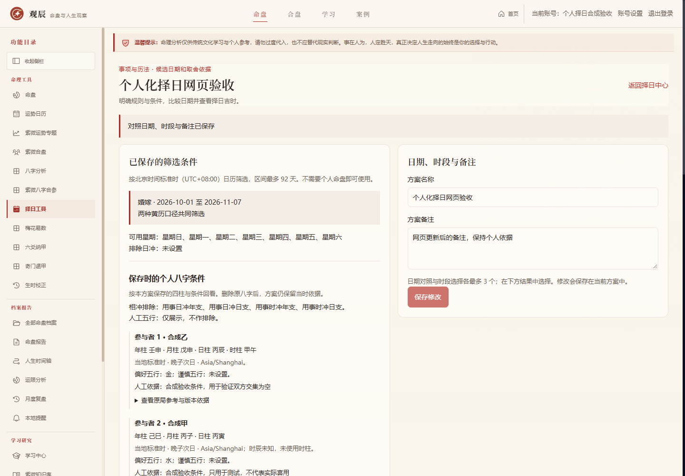
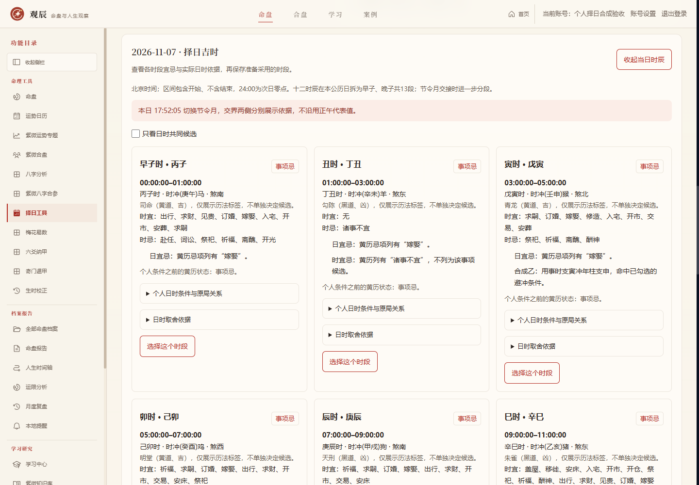

# 个人化择日实施记录

后续阶段见 [个人化择日岁运背景实施记录（2026-10-16）](./PERSONAL_ELECTION_LUCK_IMPLEMENTATION.md)。本文保留原个人化关系与人工条件阶段的版本、验收及适用范围。

本轮承接八字月令与条件复核，交付个人八字关系与人工条件择日，入口仍为 `/election`。本轮未进入六爻深化，也未提交、推送或合并远程分支。

## 使用流程

1. 在八字排盘保存命盘版本，进入择日工具，勾选“加入个人八字条件”。
2. 选择本人，或两位不同出生档案的已保存版本。四柱、时间标准与晚子时口径均来自所选版本；未知时辰不补造时柱。
3. 按需勾选用事日、时与年支、日支相冲的排除条件。默认仅展示关系，不按冲合数量评级。
4. 可填写人工确认的偏好、谨慎五行及依据。默认只展示；显式开启过滤后，仅比较用事日干、时干的五行。有偏好须命中其中一项，有谨慎须避开所选；每位有条件的参与者分别满足。
5. 筛选日期，查看逐人关系、黄历原状态与排除原因，打开当日时辰继续核对。可保存最多三个日期、三个时段及备注。

双方条件无交集时保留各自理由，允许结果为空，不以综合分数强行推荐。黄历事项忌、未列明、口径差异及晚子待核均保留；个人关系不把它们升级为候选。

## 规则与适用边界

- 实现天干五合、地支六冲、六合、同支及完整三合齐支的位置核对。三合须由用事支与原局的另外两种不同地支补齐；半合与重复同支不冒充完整三合。
- 只记录外来日或时与每位原局的关系，不将双方原局拼成一个命局，不自动判成局、合化、伏吟或现实吉凶。
- 基础关系表核对《三命通会》卷二的“论十干合”“论支元六合”“论支元三合”“论冲击”；只采用结构关系，不继承书中人物评价及命运断语。来源：[维基文库原典转录](https://zh.wikisource.org/zh-hans/三命通會/卷二)。
- 八字月令调候作为原局参考保存，不自动转成喜神、忌神，也不自动填入人工条件。完整旺衰、喜忌裁决、婚嫁等专门择日流派仍待后续校核。
- 出生四柱沿用原排盘口径，用事日期和时辰固定北京时间。晚子时的日条件仍按本公历日干支，时条件按实际时干支；节令交界按原吉时引擎的实际秒界分段。

## 服务端与数据边界

个人规则版本为 `personal-election-v1-relations-manual-elements`。数据库仍为 v56，利用原方案 JSON 存储可选个人快照，不新增表或迁移；无个人条件的旧方案保持原结果结构。

| 位置 | 职责 |
| --- | --- |
| `lib/election/personal-rules.ts` | 严格输入校验、关系表与来源 |
| `lib/election/personal-engine.ts` | 纯关系与显式条件评估 |
| `lib/election/personal-service.ts` | 当前账号来源解析、黄历与个人结果合成 |
| `lib/db/election.ts` | 服务端重算、保存、幂等、原快照更新 |
| `components/ElectionPersonalSettings.tsx` | 参与者与显式过滤条件 |
| `components/ElectionPersonalFacts.tsx` | 逐人依据、方法及历史快照 |

`GET /api/election/participants` 仅列当前账号最近200个八字版本，包含姓名、四柱、口径与版本标识，不返回出生地点或备注。新建与预览只接受来源版本标识和条件，服务端读取实际四柱；客户端名称、盘面、指纹和个人快照不能覆盖来源。

`POST /api/election/hours` 新建时接收 `{input,date}`，已保存时接收 `{planId,date}`，两种入口不混用，不接受客户端快照。所有业务请求沿用账号认证与 `private, no-store`；不存在和跨账号来源均返回404，匿名返回401，写入仍受同源校验约束。

保存的最小快照包括姓名、来源标识、四柱、时间口径、方法版本、指纹与调候参考摘要，不含出生地点和档案备注。来源八字删除后，原方案继续回看；改备注、对照选择与新增时段沿用原个人快照。来源不存在时重新筛选必须重选，不静默降级成普通黄历。未知历史规则版本不得用当前规则冒充重算，已有时段快照仍保留。

## 验收

2026-10-15（UTC+08:00）验收完成：

| 检查 | 结果 |
| --- | --- |
| 新增个人化择日专项 | 832项通过 |
| 原择日专项／吉时专项 | 158项／1005项通过 |
| 全项目回归 | 90/90组通过 |
| 生产构建、TypeScript | 通过 |
| 网页功能与真实HTTP安全边界 | 50项通过 |
| 四视图、六种宽度的布局与自动无障碍 | 24组通过，无横向溢出、无所选WCAG A/AA规则违规 |
| 本模块网页验收AI请求 | 0次 |

验收使用独立临时账号与数据库，不读取正式用户档案。专项覆盖关系表、缺位和重复支、人工条件校验、双方与未知时柱、晚子与交节、保存幂等、来源删除后新增时段、旧方案、备份恢复与账号隔离。网页还验证了列表及时辰故障重试、无候选、原生表单约束、日期／时段上限、保存刷新和源删除后的历史快照。2026-11-07的实际交节样例在北京时间17:52:05分段为14个时段。

完整网页检查项、视图宽度与结果见 [网页验收证据](./qa-evidence/2026-10-15-personal-election-web.json)，各组回归结果见 [全量回归证据](./qa-evidence/2026-10-15-personal-election-regression.json)。自动检查及响应式模拟不替代真实设备、真实命理规则适用性与实际服务部署验收。本轮未调用真实AI，也未宣称完成完整专门择日流派。

