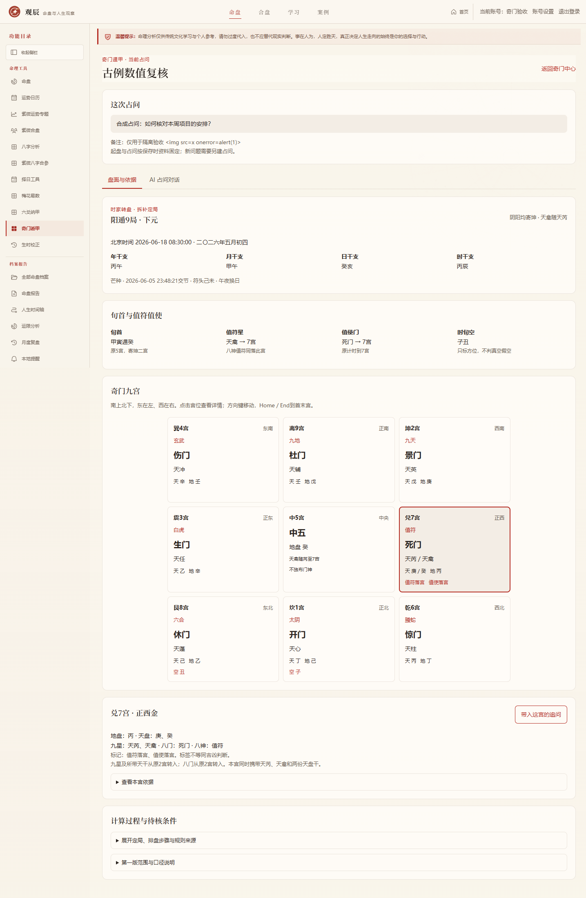
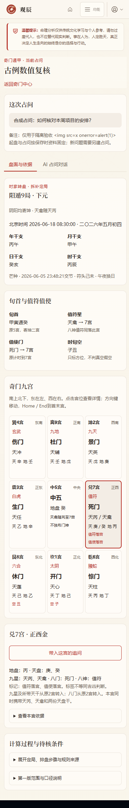

# 奇门遁甲实施记录

后续进展：2026-10-15已交付日时干与宫门星仪条件复核，见 [奇门深化实施记录](./QIMEN_READING_IMPLEMENTATION.md)。下文保留第一版基础排盘的范围与验收历史。

开发日期：2026-10-13（UTC+08:00）。第六模块在梅花易数、六爻纳甲之后实施奇门第一版，入口 `/qimen`，首页及工作台侧栏均提供入口，属于 `1.1.0-dev`。

## 第一版范围

采用时家转盘、拆补定局、阴阳俱寄坤的固定口径。支持北京时间起盘、实际交节节气、五日符头三元、阴阳十八局、时旬首及遁甲六仪、值符值使、地盘与天盘干、九星八门八神、时旬空方位；九宫按南上北下展示，点击或键盘选宫查看完整依据。保存单件占问、名称、备注和完整盘面后可独立问答，从宫位带入追问只填草稿，不自动发送。

默认按时间自动拆补定局，也可手动指定阴阳遁和1–9局用于核对。手动盘保留自动拆补参考，页面明确标注，不声称已实现置闰、茅山或其他定局法。预览不写记录、不调用AI；服务端重新计算，忽略客户端伪造结果及账号字段。

## 来源与排盘口径

定局表、三元符头、六仪、值符随时干、值使随时宫等依据 [《奇门遁甲元灵经》卷一](https://zh.wikisource.org/wiki/奇門遁甲元靈經)。九宫位置、星门原位与阴阳俱寄坤等依据 [《奇门遁甲统宗》](https://zh.wikisource.org/wiki/奇門遁甲統宗)。古籍存有不同盘法与寄宫口径，不把它们混成唯一流派；原例只核对明确的仪宫、旬首及值使数值。

- 九宫图顺序为巽4／离9／坤2、震3／中5／兑7、艮8／坎1／乾6。外八宫顺时针环为1、8、3、4、9、2、7、6。
- 地盘从局数宫布戊己庚辛壬癸丁丙乙，阳顺、阴逆九宫数字序；六甲分别遁于戊己庚辛壬癸。三奇逆序与六仪相接，不能按外环排地盘。
- 旬首仪原宫决定值符星；旬首在中五时值符名为天禽，按本版寄坤与天芮同行。时干为甲时使用当前旬首仪定位，其他时干找其地盘原宫，中五寄坤。
- 九星与所带天盘干沿外八宫整体转动，让值符到时干所在宫；阴阳遁均依目标位置计算环位移。天禽、中五仪与天芮绑定转动，共九星九干落外八宫，中五保留地盘干但不再独布活动星门神。
- 值使从旬首仪的**原始九宫**按时辰差0–9步计数，阳顺阴逆，到达中五后才寄坤。不能先把起点5映为2再计时。值使原门从寄宫原位确定，其余八门再沿外环整体移动。
- 八神从值符星落宫起，阳顺阴逆外环，顺序值符、螣蛇、太阴、六合、白虎、玄武、九地、九天。白虎、玄武采用常用名称，对应所读古籍的勾陈、朱雀下神记载；不宣称所有流派同名。
- 时旬空按时干支所属十日旬缺少的两个支映射方位宫，仅为结构标签，不判真空假空或吉凶。日旬空、驿马、暗干及其他神煞不在本版自动生成。
- 拆补以所选日干支往前取最近甲／己日为五日符头；符头支子午卯酉为上元、寅申巳亥为中元、辰戌丑未为下元。24节气各有上中下三局表，冬至后阳遁、夏至后阴遁，按实际交节秒界切换，不用公历月份近似。

原典“芒种后癸亥日丙辰时，阳九局”以2026-06-18 08:30的相同干支数值复现：旬首甲寅癸原中五，值符天禽、值使死门皆落兑七；现代日期不冒充原故事的实际发生日期。阴八辛未例核对值使生门到坎一；时干落中五时，本版明确采用寄坤，与原文允许星入中宫的盘法有所不同。

## 时间与范围

支持1900–2100年北京时间标准时，不做真太阳时校正。节气、年立春界和月十二节界复用项目现有 `lunar-javascript` 的实际交节计算，精度继承该库。默认公历午夜换日，也可显式23点子初换日。时干由**所选日干**按五鼠遁重新计算，日时口径同步，不直接使用可能采用不同晚子约定的库默认时柱；这与部分传统晚子口径有区别，页面明确记录。

## 保存、会话与安全

业务数据库升级至v55，新增 `qimen_sessions` 与 `qimen_turns`，记录完整固定盘面；后续改变时间或局数另建占问，避免已有回复依据变化。按账号隔离，匿名拒绝、跨账号读取发问停止删除拒绝，响应私有且不缓存；写入遵守统一同源检查。

独立会话只给AI当前占问、已保存九宫、口径及最多八轮完成历史。正文使用安全Markdown，必须引用1–8条现有依据，拒绝未知引用及指定绝对断言词。模型提示不允许自行补造旺衰、击刑、墓库、门迫、驿马、暗干、用神裁决或应期，也不混入梅花体用、六爻世应六亲。规则校验不等于真实解释质量已经验证。

回复整段生成后显示，支持快速问题、宫位带入草稿、停止、失败重试、请求幂等和同会话单轮生成。超时100秒，150秒过期恢复，停止会取消上游，迟到响应不能覆盖已停止或过期状态。每次读30轮，可加载更早历史。宫位带入保留既有草稿，过长时提示整理，不覆盖或自动发送。

移除占问先停止生成再级联删除对话。完整数据库备份包含奇门记录，单紫微命盘包不包含独立奇门占问；旧v54及更早备份先用兼容代码恢复后升级，不直接按v55包导入。既有命盘、梅花与六爻数据保留。

## 边界与验收

第一版完成可复核排盘及依据问答；未实现置闰、飞盘、日月年家奇门、太阳时、自动用神、精细旺衰、格局裁决、精确应期与确定性吉凶评分，也未内置完整古籍断语。当前阶段不把这些条件交给AI自行补造。

2026-10-13（UTC+08:00）验收完成：

- `npm run test:qimen`：7849项断言通过，包含十八局×六十时干支、九星九干八门八神不重不漏、旬首中五与值使到中五、古籍数值例、24节气三元、二至秒界、日时换日同步、非法输入、会话生命周期、账号隔离、备份及旧数据迁移。
- `npm run test:v1-all`：87/87组通过；生产构建通过。
- 浏览器在独立临时账号完成40项功能安全检查：首页入口、自动与手动起盘、换日、九宫及键盘选择、保存、草稿追加、Markdown、引用、停止重试、三十轮分页、搜索移除、故障恢复、匿名与跨账号及同源边界等。
- 5种视图（首页、自动预览、手动预览、盘面、聊天）×6种宽度（1440、1024、820、768、390、320），共30组无横向溢出，axe扫描未发现WCAG 2 A/AA与2.1 AA所选规则违规。已人工查看桌面九宫、手机九宫与聊天截图；自动检查不等于完整人工无障碍认证或真机验收。
- 修正宫位追问追加长度检查：计入原草稿尾部空白，避免超过2000字；实际浏览器验证保留原文和真实空行，过长时不覆盖。

证据：[网页功能与布局](./qa-evidence/2026-10-13-qimen-browser.json)、[全量回归](./qa-evidence/2026-10-13-qimen-regressions.json)。网页AI链路使用本机模拟供应商，只验证功能与状态管理，真实模型解释质量与实际设备另行核对。未提交、推送或改动远程版本标签。

